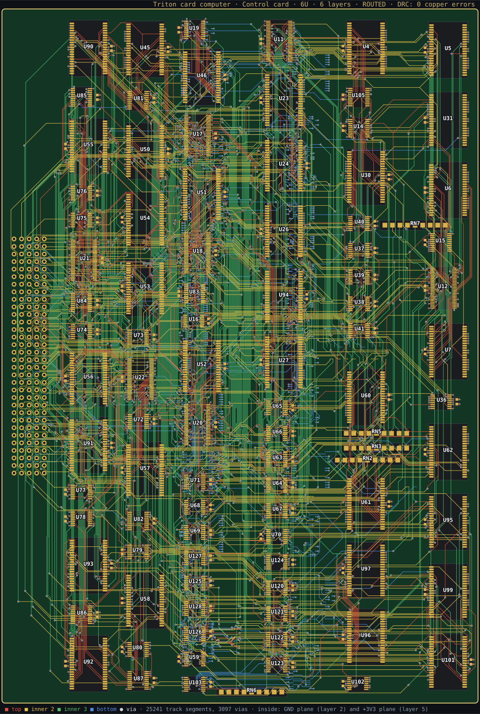

# Triton-card-computer
A ConsciousNode SoftWorks approach to Balanced Ternary Computing hardware.

A balanced-ternary computer built from stock discrete logic: six cards on a backplane, meant to run
[Triton 4](https://github.com/ConsciousNode/Triton) and TritOS Desktop. Every card is specified as a
chip-by-chip netlist and checked cycle by cycle against a reference microcode simulator, which is itself checked
against the Triton emulator.

**Status (2026-11-24):** simulated as a whole machine, and five of the six boards are laid out and routed.
- **The whole machine runs in simulation.** All six cards, joined through the backplane, run in lockstep with the
  reference microsim. It boots and prints `POOP OK`, runs real programs, traps and user mode, and drives every
  device: console, timer and clock, SD card, PS/2 keyboard and mouse, and Video, down to a whole VGA frame captured
  at the DAC. The KERK front panel (run, stop, single-step by instruction or microcycle) is drawn and tested.
  Details are in `INTEGRATION-PLAN.md`.
- **Every card is a real KiCad board** (6U, six layers). Registers, I/O, ALU, Video and Control are autorouted
  with 0 unconnected pads and 0 copper errors in KiCad's checker. **Memory** (241 chips, two-sided) is the
  biggest: it was routing on Kham's laptop on 2026-11-24, after cloud runs kept being cut short. Details and
  pictures are in `kicad/KICAD.md`.
- **JPUSB**, the discrete-logic USB card from [Bare-USB](https://github.com/ConsciousNode/Bare-USB), is translated
  into this repo's part library and cross-checked net by net against its own simulator (`jpusb/`).
- **Not yet:** pinouts and land patterns still need a final check against datasheets, some chips on the table-loading
  path aren't on the boards yet, and nothing has been built on a bench.



*The Control card ("Ed"): 129 chips on both faces, autorouted on six layers.*

## What "ternary" means here
- **Trits are dual-rail:** each trit travels on two binary wires (+ and −), and one of the four combinations is
  never used. That's the same trick Setun used with pairs of ferrite cores, and the same as most ternary hardware
  ever built. Truly three-level devices are still a research frontier.
- **The ternary is in the machine's structure, not in a program.** Arithmetic and decoding are done by wiring and
  by lookup tables held in SRAM. There's **no microcontroller, no FPGA, and no firmware** pretending to be ternary
  anywhere in the machine. Binary parts are used the way Setun used them, as building blocks.
- You can put a probe on a register's two wires and read a trit.

## The cards
Named after the ConsciousNode crew:

| Card | Name | Job |
| --- | --- | --- |
| I/O | Kehai | serial console, timer and real-time clock, SD card, keyboard, ports |
| Video | Komo | framebuffer and display scan-out |
| ALU | Testsuo | arithmetic, shifts, flags |
| Registers | Ren | register file |
| Control | Ed | microsequencer and control store |
| Memory | Vael | main memory |

Front panel: the **KERK panel**. The boot self-test is the **Power On Operational Precheck**; a good boot prints `POOP OK`.

## Layout
- `cards/`: each card's netlist (`*-card.js`), its tables, and its test against the microsim (`*-card-test.js`).
  `netlist.js` and `parts.js` are the part-level simulator; parts carry real part numbers (see `PARTS.md`).
- `microsim/`: the reference microcode simulator, ROMs and bare-metal drivers.
- `integration/`: the backplane check (reads every card's netlist at once) and its findings.
- `roms/`: control-store and table images.
- `kicad/`: the board pipeline (netlist to placed, autorouted `.kicad_pcb`), routed boards and renders in `out/`,
  and `KICAD.md`, the log of how each board was routed.
- `jpusb/`: the JPUSB card brought into the part library, and its cross-check.
- `handheld/`: early ideas for a ternary handheld.
- `TRITONE-CASSETTE.md`: Tritone, a sketch for a ternary cassette drive (three tones, one per trit).
- `NOTES.md`: the working log, kept as written, including superseded plans.
- Design docs: `BACKPLANE-PINOUT.md`, `CONTROL-SIGNALS.md`, `INTEGRATION-PLAN.md`, `PARTS.md`, `TIMING-BUDGET.md`,
  `SHIFTER.md`, `TRITON-4-STORAGE-TIME.md`, `PRIOR-ART.md`, `PCB-PRICING-RECON-testsuo.md`.

## Running the tests
Needs Node.js and a checkout of [ConsciousNode/Triton](https://github.com/ConsciousNode/Triton) next to this repo
(`../Triton`), or set `TRITON_DIR`. The tests compare each card against the Triton reference.

```
cd cards
node alu-card-test.js directed
node control-card-test.js directed
node io-ports-test.js console
```

Each test also has deliberately broken variants ("mutants") that the test must catch.

## Prior art and neighbors
- **Setun** (Moscow State University, 1958) and **Setun-70**: the ternary machines this design descends from.
- **5500FP** by Claudio Lorenzo La Rosa: a 24-trit balanced-ternary RISC processor on an FPGA (2026). It's the
  modern, fast path; this repo is the fixed-discrete-hardware path. Different answers, both worth having. (Our own
  rule for this machine and anything after it: no FPGA and no emulation. The road past discrete chips is a cost-down
  and, someday, a real ternary ASIC.)
- See `PRIOR-ART.md` for more.

## License
MIT, see `LICENSE`.
